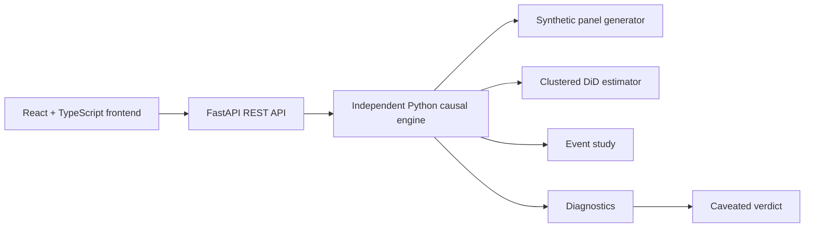

# Causal Impact Validation Platform

> **Production portfolio project** — a cautious Difference-in-Differences decision-support tool for intervention analysis.

[](https://civp-frontend.onrender.com)
[](https://civp-api.onrender.com/docs)
[](https://github.com/pattysaurus/causal-impact-validation-platform/actions)
[](https://www.python.org/)
[](https://react.dev/)

**[Open the live app](https://civp-frontend.onrender.com)** · **[Explore the API](https://civp-api.onrender.com/docs)** · **[Read the methodology](docs/methodology.md)**

## Why this project exists

Many intervention analyses stop at a single regression coefficient. CIVP makes the evidence around that coefficient visible: a known synthetic ground truth, an estimated DiD effect, an event study, structured diagnostic checks, and a deterministic verdict with an unavoidable caveat.

It is designed to answer a practical question:

> **Is this estimate consistent with a credible DiD design—or should we not trust it?**

The platform never treats passing diagnostics as proof of causality.

## What is live today

| Capability | Current implementation |
| --- | --- |
| Synthetic validation | Deterministic, fixed-seed panel generator with known treatment effects and intentionally broken scenarios |
| Estimation | Baseline DiD: `outcome ~ treated + post + treated × post` with unit-clustered inference by default |
| Dynamic evidence | Event-study effects relative to the final pre-treatment period (`t-1`) |
| Diagnostic evidence | Pre-trend, placebo-in-time, data adequacy, control quality, small-cluster, and precision/power checks |
| Decision support | Deterministic **Credible**, **Suggestive**, or **Don't trust this estimate** verdicts with next steps and caveats |
| Product layer | React + TypeScript + Vite frontend and FastAPI REST API |
| Delivery | Render deployment, Docker Compose configuration, and GitHub Actions CI |

## Try the evidence workbench

The live frontend includes five reproducible synthetic scenarios:

- **Clean** — a panel constructed with parallel untreated trends.
- **Non-parallel** — a treated-only pre-trend designed to raise concern.
- **Early effect** — a fake treated-group shift before the real intervention.
- **High noise** — an intentionally imprecise estimate.
- **Missing data** — model estimates are withheld while diagnostics remain visible.

Start with **Clean**, then compare it with the broken scenarios. The goal is not to make every analysis pass; it is to show why an estimate should or should not be trusted.

## Architecture



The causal engine is deliberately independent of routes and UI code so its statistical logic can be tested in isolation.

## Validation evidence

- **58 deterministic automated tests** cover simulation, DiD, event study, diagnostics, verdicts, reporting, and API contracts.
- A **200-run fixed-seed recovery experiment** observed **94.5%** coverage for the clustered 95% interval, above the project’s 90% calibration threshold.
- The suite deliberately tests failure modes: non-parallel trends, early fake effects, too few controls, high noise, and missing data.

This validates the platform against its own known synthetic data-generating process. It does **not** validate a real-world causal claim.

## Methodological guardrails

- A non-significant pre-trend test does **not** prove parallel trends.
- Small cluster counts can make conventional cluster-robust inference unreliable.
- Every verdict, including **Credible**, displays a methodological caveat.
- The current scope supports one intervention date, one treated group, binary treatment, and balanced or near-balanced panels.
- Staggered adoption and heterogeneous treatment timing are intentionally out of scope.

Read the full [methodology](docs/methodology.md) and [limitations](docs/limitations.md).

## Roadmap

| Stage | Status | Notes |
| --- | --- | --- |
| Tier 1 — statistical engine | Complete | Synthetic validation, tested DiD/event study, diagnostics, verdicts, reporting, and documentation |
| Tier 2 — product and delivery | Complete | Frontend, API, Docker configuration, CI, and live Render services |
| Delhi Odd-Even / CPCB case study | Started carefully | Official-source discovery and data protocol are documented; no real-world result has been fabricated or modeled |
| Next | Planned | Acquire provenance-rich source data, define a defensible control design before estimation, and accept “Don't trust this estimate” if diagnostics require it |

## Run locally

```powershell
# Terminal 1 — API
cd backend
python -m pip install -r requirements.txt
python -m uvicorn app.main:app --host 127.0.0.1 --port 8000

# Terminal 2 — frontend
cd frontend
npm install
npm run dev
```

Open `http://localhost:5173`. For containers, run `docker compose up --build` from the repository root.

## Verify it yourself

```powershell
cd backend
python -m pytest -q

cd ../frontend
npm run build
```

## Documentation

- [API contract](docs/API.md)
- [Methodology and thresholds](docs/methodology.md)
- [Limitations](docs/limitations.md)
- [Module walkthrough](docs/WALKTHROUGH.md)
- [Deployment guide](docs/DEPLOYMENT.md)
- [Delhi Odd-Even / CPCB case-study protocol](docs/CASE_STUDY.md)
